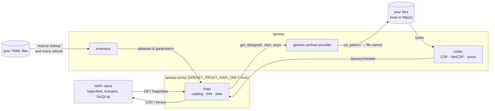
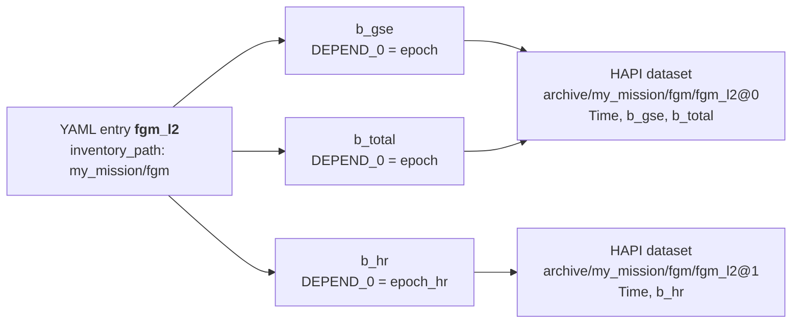

# Run your own HAPI server over your own files

speasy-proxy ships a [HAPI](https://hapi-server.org) 3.2 server at `/hapi`.
It serves anything speasy can read.
That includes your own files, through speasy's **generic archive** provider.

So publishing a mission archive as HAPI takes three things:

1. A YAML file that says where your files are and what is in them.
2. A codec, only if speasy can't already read the format (CDF and NetCDF are built in).
3. A few environment variables.

No Python code in speasy-proxy to touch.
HAPI clients (hapiclient, Autoplot, SciQLop, the HAPI verifier) then see your data like any other server's.

This page covers the HAPI side.
speasy's [direct archive access guide](https://speasy.readthedocs.io/en/latest/user/direct_archive/direct_archive.html) has the full details on the YAML inventories and on codecs.

## How it fits together

At startup, speasy reads your YAML files and builds its inventory.
speasy-proxy turns that inventory into the HAPI catalog.
A `/data` request then goes down to your files and back:



Each box on the right is a place to plug in your own code:

| You want to… | Hook | Section |
|---|---|---|
| Publish files speasy can read (CDF, NetCDF) | a YAML file | [1](#1-describe-your-files) |
| Read another file format | a codec | [3](#3-write-a-codec) |
| Serve data that isn't in files | your own `fetch` | [4](#4-other-hooks) |
| Add a whole new data source | a speasy provider | [4](#4-other-hooks) |

## 1. Describe your files

Drop a `*.yaml` file in a directory of your choice.
Each top-level key is one dataset.

### ISTP CDF files

If your files are ISTP CDFs, point at a master (or any one file).
speasy reads the variable list, units, fill values and time axes from it.

```yaml
fgm_l2:                                   # dataset name
  inventory_path: my_mission/fgm          # where it sits in the tree
  master_file: /srv/my_mission/fgm/master/mm_fgm_l2_00000000_v01.cdf
  url_pattern: /srv/my_mission/fgm/{Y}/mm_fgm_l2_{Y}{M:02d}{D:02d}_v\d+.cdf
  split_rule: regular                     # one file per period
  split_frequency: daily                  # daily | monthly | yearly | none
  use_file_list: true                     # list the directory: needed for regexes in names, skips missing days
  meta:
    start_date: 2015-09-01T00:00:00Z      # required by HAPI
    stop_date: 2024-12-31T00:00:00Z
```

The dataset shows up in HAPI as `archive/my_mission/fgm/fgm_l2`.
Variables on different time axes (`DEPEND_0`) are split into one HAPI dataset each, as `…@0`, `…@1`.
This is what CDAWeb's own HAPI server does.



With a single time axis there is no suffix: just `archive/my_mission/fgm/fgm_l2`.

### Any other format

List the variables inline and name the codec that reads the files:

```yaml
solar_wind:
  inventory_path: my_mission
  url_pattern: /srv/my_mission/sw/{Y}/sw_{Y}{M:02d}{D:02d}.csv
  split_rule: regular
  split_frequency: daily
  use_file_list: true
  codec: sw_csv                           # a codec name, file extension or mime type
  meta:
    title: My mission solar wind moments
    start_date: 2024-01-01T00:00:00Z
    stop_date: 2024-01-03T00:00:00Z
  variables:
    density: {meta: {UNITS: cm^-3, CATDESC: Proton density}}
    speed:   {meta: {UNITS: km/s,  CATDESC: Bulk speed}}
```

Without `DEPEND_0`, inline variables are taken as sharing one time axis.
`/data` still checks it when it merges them.

### The YAML keys

| Key | Meaning |
|---|---|
| `inventory_path` | Folder in the inventory tree; part of the HAPI dataset id |
| `url_pattern` | Local path or http(s) URL. `{Y}`, `{M:02d}`, `{D:02d}`… are the period's date; regexes are allowed with `use_file_list` |
| `split_rule` | `regular` (one file per day/month/year) or `random` (files cover arbitrary spans) |
| `split_frequency` | `daily`, `monthly`, `yearly` or `none` |
| `fname_regex` | `random` only: regex with a `(?P<start>…)` group (and optionally `stop`, `version`) giving each file's span |
| `date_format` | `random` only: strptime format of `start`/`stop` when not ISO |
| `use_file_list` | List the directory instead of building one exact name. Turn it on: without it a missing day is an error |
| `master_file` | File the variable list and metadata are read from (`master_cdf` is the legacy spelling) |
| `codec` | Codec reading the files; defaults to CDF |
| `variables` | Inline variable list, for codecs that can't describe a master |
| `meta` | Dataset metadata. HAPI needs `start_date`/`stop_date`; `title` and `description` are shown in `/catalog` and `/info` |
| `meta_priority` | `file` (default) or `yaml`: who wins when a file and the YAML disagree on a metadata key |

speasy's bundled `cda.yaml` (in `speasy/data/archive/`) has many more real examples.
speasy documents every field in its [YAML field reference](https://speasy.readthedocs.io/en/latest/user/direct_archive/direct_archive.html#yaml-field-reference),
including [URL placeholders](https://speasy.readthedocs.io/en/latest/user/direct_archive/direct_archive.html#url-pattern-placeholders), [randomly split (burst) datasets](https://speasy.readthedocs.io/en/latest/user/direct_archive/direct_archive.html#randomly-split-datasets-burst-data)
and [troubleshooting](https://speasy.readthedocs.io/en/latest/user/direct_archive/direct_archive.html#troubleshooting).
A dataset without `start_date`/`stop_date` is left out of HAPI (it stays usable through speasy).

## 2. Run it

```bash
export SPEASY_ARCHIVE_EXTRA_INVENTORY_LOOKUP_DIRS=/srv/hapi/inventories   # your YAML files
export SPEASY_CORE_USER_CODECS_EXTRA_DIRS=/srv/hapi/codecs                # your codecs, if any
export SPEASY_CORE_DISABLED_PROVIDERS=amda,cda,csa,ssc,cdpp3dview,uiowaephtool   # serve only your archive
export SPEASY_PROXY_HAPI_ONLY=true                                        # no web pages, no /get_data
export SPEASY_PROXY_HAPI_SERVER_ID=my-mission
export SPEASY_PROXY_HAPI_TITLE="My mission HAPI server"
export SPEASY_PROXY_HAPI_CONTACT=data@my-mission.org
export SPEASY_PROXY_INDEX_PATH=/srv/hapi/state                            # persistent: holds the /info cache
export SPEASY_CACHE_PATH=/srv/hapi/cache SPEASY_INDEX_PATH=/srv/hapi/index

uv run gunicorn speasy_proxy:app --preload -k speasy_proxy.UvicornWorker.SpeasyUvicornWorker
```

The same variables work with the container (`docker/build.sh`, then `podman run -e …`); mount the three directories.

Then check it:

```bash
curl http://localhost:8000/hapi/catalog
curl 'http://localhost:8000/hapi/info?id=archive/my_mission/solar_wind'
curl 'http://localhost:8000/hapi/data?id=archive/my_mission/solar_wind&time.min=2024-01-01T22:00:00Z&time.max=2024-01-02T02:00:00Z'
```

Things worth knowing:

- **`/info` is built from real data.** The first call for a dataset reads a sample of your files.
  It is cached for 7 days in `SPEASY_PROXY_INDEX_PATH`, shared by all workers.
- **New YAML files are picked up** at the next inventory refresh (`SPEASY_PROXY_CORE_INVENTORY_UPDATE_INTERVAL`, 2 h by default) or on restart.
- **Remote files are cached** by speasy in `SPEASY_CACHE_PATH`.
  `SPEASY_CORE_HTTP_REWRITE_RULES` can redirect a public URL to a local mirror.
- **gzip** is left to the reverse proxy. Add `text/csv` and `application/json` to nginx's `gzip_types`.
- **HAPI wants a URL ending in `/hapi`.** Use `SPEASY_PROXY_PREFIX` when it sits under a sub-path.

You can keep the full proxy instead (drop `SPEASY_PROXY_HAPI_ONLY`): your archive then also shows in `/plot` and `/get_data`.

## 3. Write a codec

A codec is a class with `load_variable(s)`, a unique `name`, and the extensions and mime types it claims.
The full interface is `speasy.core.codecs.CodecInterface`.
`load_variable` gets a path or URL and returns a `SpeasyVariable`.

```python
from speasy.core.codecs import register_codec


@register_codec
class SolarWindCsv:
    def load_variables(self, variables, file, cache_remote_files=True, **kwargs):
        # Imports live here: speasy exec()s drop-in codec files, module-level names don't reach methods.
        import io
        import pandas as pd
        from speasy.core.any_files import any_loc_open
        from speasy.products import SpeasyVariable, VariableTimeAxis, DataContainer
        with any_loc_open(file, mode='rb', cache_remote_files=cache_remote_files) as f:
            df = pd.read_csv(io.BytesIO(f.read()), parse_dates=["time"])
        time = df["time"].dt.tz_localize(None).to_numpy(dtype="datetime64[ns]")
        return {v: SpeasyVariable(axes=[VariableTimeAxis(values=time)],
                                  values=DataContainer(df[v].to_numpy(dtype="float64").reshape(-1, 1), name=v))
                for v in variables}

    def load_variable(self, variable, file, cache_remote_files=True, **kwargs):
        return self.load_variables([variable], file, cache_remote_files, **kwargs).get(variable)

    def save_variables(self, variables, file=None, **kwargs):
        raise NotImplementedError()

    def list_variables(self, file):
        raise NotImplementedError()   # implement it to use `master_file` instead of inline `variables`

    supported_extensions = []         # claiming "csv" would clash with other CSV codecs
    supported_mimetypes = []
    name = "sw_csv"
```

speasy's guide goes further: [writing a reusable codec](https://speasy.readthedocs.io/en/latest/user/direct_archive/direct_archive.html#writing-a-reusable-codec-recommended)
and [shipping it as a package](https://speasy.readthedocs.io/en/latest/user/direct_archive/direct_archive.html#shipping-a-codec-as-a-package).

`any_loc_open` reads local paths and URLs alike, and caches remote files.
Metadata you put in `DataContainer(meta=…)` (`UNITS`, `FILLVAL`, `CATDESC`…) reaches `/info`; the YAML `meta` can fill or override it.

There are three ways to install a codec:

| Where | How |
|---|---|
| speasy's user codec dir | Drop the `.py` in `~/.local/share/speasy/codecs/` (`speasy.core.codecs.user_codecs_dir()`) |
| Any directory | List it in `SPEASY_CORE_USER_CODECS_EXTRA_DIRS` (comma separated) |
| A Python package | Declare an entry point; best for anything you version and test |

Drop-in files are run with a bare `exec()`.
That is why the example imports inside its methods.
A packaged codec doesn't have that problem:

```toml
# pyproject.toml of your package
[project.entry-points."speasy.codecs"]
sw_csv = "my_mission_codecs:register"
```

```python
# my_mission_codecs/__init__.py
from speasy.core.codecs import register_codec
from .sw_csv import SolarWindCsv

def register():
    register_codec(SolarWindCsv)
```

`pip install` it next to speasy-proxy and it loads at `import speasy`.
A failing plugin is logged and skipped. `SPEASY_CORE_DISABLED_PLUGINS` turns one off by name.

## 4. Other hooks

- **Your own data source, no files at all.** `speasy_proxy.hapi` is a self-contained FastAPI sub-app.
  `create_hapi_app(fetch=…)` takes any `fetch(path, start, stop, **options) -> SpeasyVariable`.
  Mount it in your own app to serve a database or a model output:

  ```python
  from datetime import timedelta
  from fastapi import FastAPI
  from speasy_proxy.hapi import create_hapi_app

  app = FastAPI()
  app.mount("/hapi", create_hapi_app(fetch=my_fetch, info_cache_path="/srv/hapi/info",
                                     max_request_duration=timedelta(days=366),
                                     server_id="my-server", title="My server"))
  ```

  The catalog still comes from speasy's inventory (`inventories=` replaces it, e.g. for tests).
- **Your own speasy provider.** A `speasy.core.dataprovider.DataProvider` subclass registered with `@register_provider` gets the same treatment in `/get_data`.
  HAPI maps a fixed list of providers (`_PROVIDERS` in `speasy_proxy/hapi/catalog.py`); a new one needs an entry there saying how its inventory becomes HAPI datasets.
- **Conformance.** `tests/hapi_conformance/check.py` runs the official HAPI verifier and `hapiclient` on every dataset of a server.
  Run it on your own instance before announcing it (`run.sh` shows how to fetch the verifier):

  ```bash
  uv run --with hapiclient python tests/hapi_conformance/check.py \
      --url http://localhost:8000/hapi --verifier path/to/verifier-nodejs/verify.js
  ```
